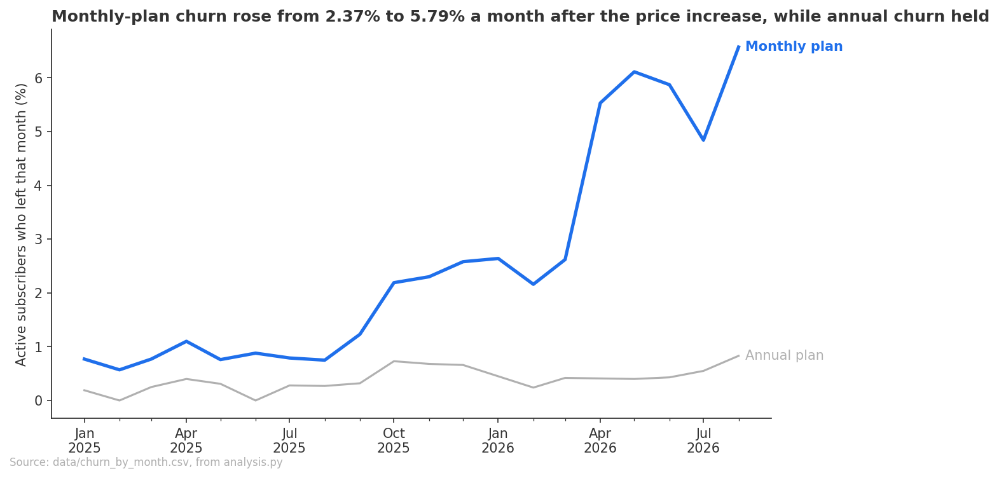
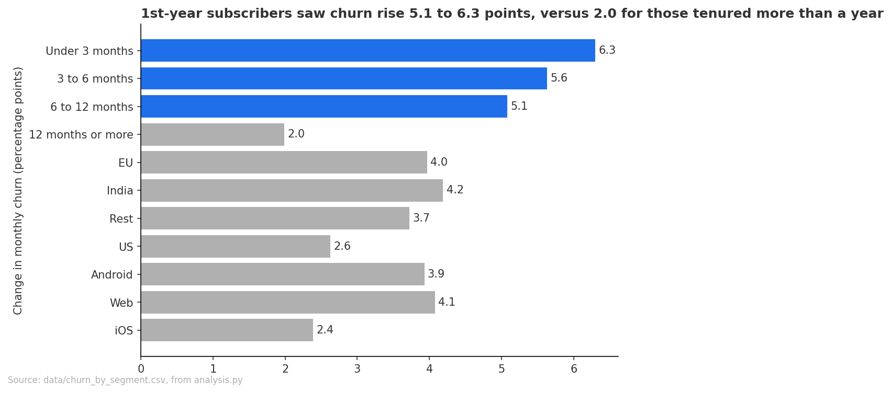

# The March 2026 price increase and retention

## Objective
Did the March 2026 price increase hurt retention, and for whom? This brief informs whether to roll back part of the increase for some customers, a decision the head of growth makes.

## Key Takeaways
- Monthly-plan churn rose from 2.37% a month (October 2025 to February 2026) to 5.79% (April to August 2026) after the price increase: up 3.42 percentage points, or 144.3% relative, while annual-plan churn, whose price did not change, held at 0.55% and 0.53%.
- Subscribers in their first year were hurt most: their churn rose 5.08 to 6.30 percentage points, against 1.99 points for subscribers past a year.
- US and iOS subscribers were hurt least: churn rose 2.63 points in the US, against 3.72 to 4.19 points in the other markets, and 2.39 points on iOS, against 3.93 on Android and 4.08 on Web.
- Monthly-plan revenue still rose 29.4% relative, from \$50,730 to \$65,635 a month, so the higher price has outweighed the higher churn so far.

## Recommendations
1. If you roll back, aim at subscribers in their first year. Their churn rose most, to between 8.52% and 9.63% a month, while subscribers past a year only had churn rise to 3.20%.
2. Size any rollback against the revenue it gives up. Monthly-plan revenue is up 29.4% since the increase, and five months are too few to show whether higher churn will shrink the base enough to cancel that out.
3. Test the rollback before rolling it out. Every monthly subscriber moved to the new price, so nothing here shows that returning a group to \$10 would bring its churn back down. Offering it to part of the first-year group and comparing churn with the rest would settle it.

## Analysis
### Monthly-plan churn rose from 2.37% to 5.79% a month after the price increase, while annual-plan churn held.

**Figure 1:** Monthly churn rate for monthly and annual plans  
Source: `data/churn_by_month.csv`, from `analysis.py`.

### Churn rose on both plans in late 2025, but only monthly-plan churn rose again after the increase, by 3.42 points.
| Plan | January to August 2025 (%) | October 2025 to February 2026 (%) | April to August 2026 (%) | Change after the increase (points) |
| --- | --- | --- | --- | --- |
| Monthly | 0.80 | 2.37 | 5.79 | 3.42 |
| Annual | 0.22 | 0.55 | 0.53 | -0.02 |

**Table 1:** Pooled monthly churn rate by plan in three windows  
Source: `data/churn_before_after.csv`, from `analysis.py`.

### After the increase, 355 monthly-plan leavers were marked canceled, against none before.
| Window | Canceled | Expired |
| --- | --- | --- |
| October 2025 to February 2026 | 0 | 626 |
| April to August 2026 | 355 | 1198 |

**Table 2:** Monthly-plan subscribers left/status by window  
Source: `data/leavers_by_status.csv`, from `analysis.py`.

### 1st-year subscribers saw churn rise 5.1 to 6.3 points, versus 2.0 for those tenured more than a year.

**Figure 2:** Segmented change in monthly-plan churn in percentage points  
Source: `data/churn_by_segment.csv`, from `analysis.py`.

### Subscribers under 3 months had churn skyrocket from 3.33% to 9.63% a month.
| Group | Before (%) | After (%) | Change (points) | Change (relative %) |
| --- | --- | --- | --- | --- |
| Under 3 months | 3.33 | 9.63 | 6.30 | 189.4 |
| 3 to 6 months | 3.49 | 9.12 | 5.63 | 161.5 |
| 6 to 12 months | 3.43 | 8.52 | 5.08 | 148.0 |
| 12 months or more | 1.21 | 3.20 | 1.99 | 164.9 |
| Started in September 2025 | 3.93 | 8.78 | 4.85 | 123.3 |
| Started in another month | 1.96 | 5.28 | 3.32 | 168.9 |

**Table 3:** Monthly-plan churn before and after by tenure at the start of each month  
Source: `data/churn_by_segment.csv`, from `analysis.py`.

### US and iOS subscribers had the smallest increases in churn.
| Group | Before (%) | After (%) | Change (points) | Change (relative %) |
| --- | --- | --- | --- | --- |
| EU | 2.20 | 6.17 | 3.97 | 180.0 |
| India | 2.42 | 6.62 | 4.19 | 173.2 |
| Rest | 2.75 | 6.47 | 3.72 | 135.1 |
| US | 2.24 | 4.88 | 2.63 | 117.6 |
| Android | 2.27 | 6.20 | 3.93 | 172.7 |
| Web | 2.88 | 6.96 | 4.08 | 141.3 |
| iOS | 2.00 | 4.39 | 2.39 | 119.7 |

**Table 4:** Monthly-plan churn before and after by country and by device  
Source: `data/churn_by_segment.csv`, from `analysis.py`.

### Monthly-plan revenue rose 29.4%, after the increase, to \$65,635 a month.
| Window | Months | Average monthly revenue | Change (relative %) |
| --- | --- | --- | --- |
| Before | October 2025 to February 2026 | \$50,730 | |
| After | April to August 2026 | \$65,635 | 29.4 |

**Table 5:** Average monthly revenue from monthly-plan payments before and after the increase  
Source: `data/revenue_before_after.csv`, from `analysis.py`.

### Revenue was higher in every month after the increase than in any month before it.
| Month | Payments | Revenue | Notes |
| --- | --- | --- | --- |
| 2025-10 | 4964 | \$49,640 | Before window starts, \$10 a payment |
| 2025-11 | 4899 | \$48,990 | |
| 2025-12 | 5182 | \$51,820 | |
| 2026-01 | 5323 | \$53,230 | |
| 2026-02 | 4997 | \$49,970 | |
| 2026-03 | -- | -- | Price rises to \$12, left out as the transition month |
| 2026-04 | 5453 | \$65,436 | After window starts, \$12 a payment |
| 2026-05 | 5479 | \$65,748 | |
| 2026-06 | 5238 | \$62,856 | |
| 2026-07 | 5625 | \$67,500 | |
| 2026-08 | 5553 | \$66,636 | September 2026 is left out as incomplete |

**Table 6:** Monthly-plan payments and revenue by month, October 2025 to August 2026  
Source: `data/monthly_revenue.csv`, from `analysis.py`.

## Checks
- **Review:** Think on it (`review.md`). Its small fix was applied before this brief: the January to August 2025 baseline now appears in Table 1 for both plans.
- **Verified:** No join multiplies rows, and each monthly subscription can leave only once. The headline churn recomputes to the same 2.37% and 5.79% by a second method. Every monthly payment from 2026-03-01 is \$12, including subscribers who started before March, so the increase reached the whole monthly base. Adding March 2026 to the after window gives 5.25%, so leaving March out does not drive the result. The country and device gaps hold within tenure bands, so they are not a tenure gap.
- **Not verified:** Whether a rollback would pay for itself, since the revenue it gives up was not sized against the subscribers it would keep (review finding 2, not applied). Whether a rollback would bring churn back down, since no group kept the old price. Churn after August 2026, since September is cut off on the 24th and 154 scheduled cancellations have not ended yet. What "canceled" and "expired" mean, since the statuses are not defined anywhere. Subscriptions that start and leave in the same month are not counted, which slightly understates the rise.
- **Quirks:** Monthly price change: payments confirm \$10 before 2026-03-01 and \$12 from then on, with the annual price unchanged at \$100. Free plans never end: free plans are left out. Future end dates: 154 monthly subscriptions with a scheduled end after 2026-09-24 count as active. Future start dates: 1,549 subscriptions starting after 2026-09-24 are left out. September 2025 spike: churn stepped up on both plans in October 2025, and the September 2025 cohort is shown as its own group in Table 3. Timestamps everywhere: months are calendar months, and the cutoff is the end of 2026-09-24. Payments start in 2025: payments are used only for the price check and for revenue from October 2025. One row per user: the join to users is safe.
