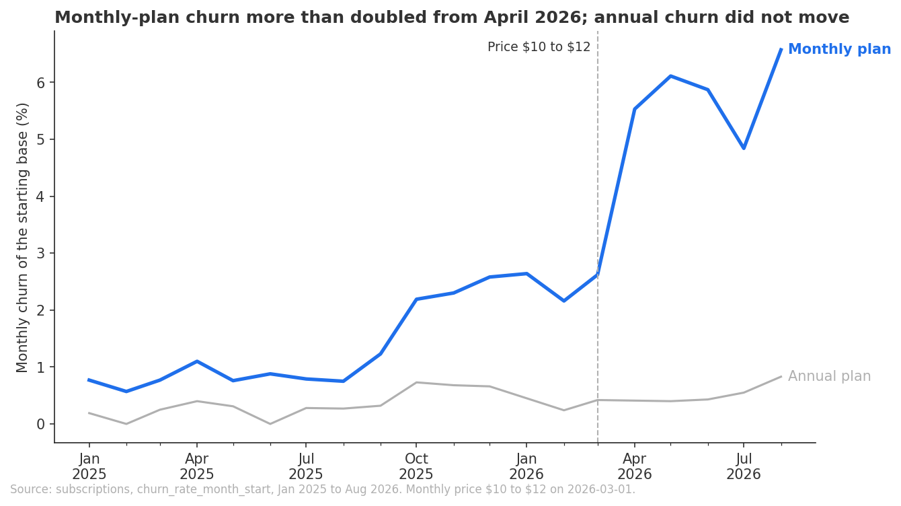
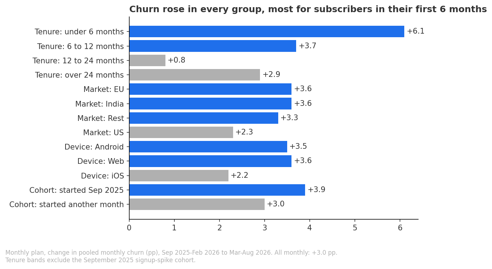
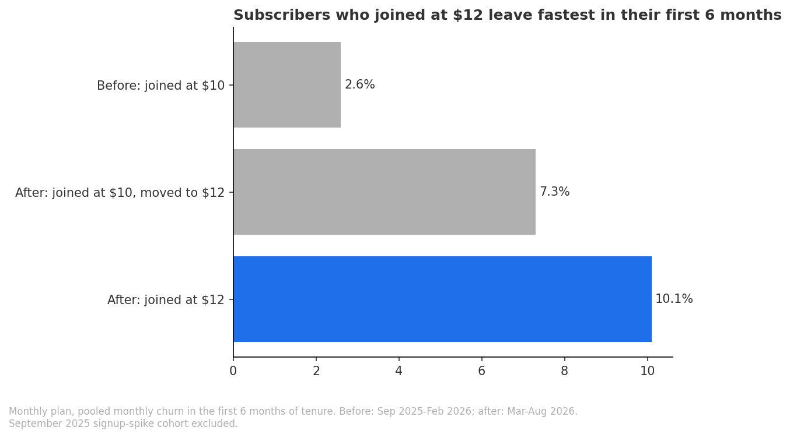
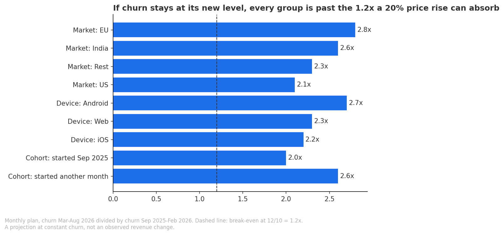

# The March 2026 price increase and monthly-plan retention

## Objective
Did the March 2026 price increase hurt retention, and for whom? The answer informs whether to roll back part of the increase for some customers, a decision the head of growth makes.

## Key Takeaways
- Monthly-plan churn rose from 2.22% a month (September 2025 to February 2026) to 5.25% (March to August 2026) after the price went from \$10 to \$12, up 3.03 percentage points or 137% relative, while annual-plan churn, whose price did not change, held at 0.52% and 0.51%.
- Churn rose in every group of monthly subscribers, most for those in their first 6 months (up 6.07 percentage points, from 2.57% to 8.64%) and least for those 12 to 24 months in (up 0.76 points), with US and iOS subscribers rising less (2.34 and 2.17 points) than the other markets and devices (3.29 to 3.63 points).
- Subscribers who joined at \$12 churn 10.14% a month in their first 6 months, 2.80 percentage points above those who joined at \$10 and were moved to \$12 (7.34%), and against 2.57% for new subscribers before the increase.
- Cash from monthly payments rose 30.4% relative in the six months after the increase, but every group's churn rose 2.0x to 2.8x, past the 1.2x a 20% price rise can absorb, so if churn stays at its new level a monthly subscriber is projected to bring in \$228 instead of \$451 (49% less).

## Recommendations
1. **Don't treat this as a problem of a few groups.** Churn rose 2.0x to 2.8x in every market, on every device, and in both start cohorts, past the 1.2x a 20% price rise can absorb. If churn stays at this level, the increase costs revenue in each of them, so a rollback for one group leaves the loss in place everywhere else.
2. **If you start with one group, start with new subscribers, including those who joined at \$12.** Subscribers in their first 6 months had the largest rise (6.07 points), and those who joined at \$12 churn fastest (10.14% a month). A rollback that only returns existing subscribers to \$10 would miss the group leaving fastest. Subscribers 12 to 24 months in (up 0.76 points) have the weakest case for one.
3. **Test a rollback before rolling it out, and keep watching churn.** No monthly subscriber kept the \$10 price, so the data cannot show that a rollback would bring churn back down. Offering the lower price to a random share of new monthly subscribers and comparing their churn over a few months would settle it. Churn shows no sign of settling yet: it ran 4.84% to 6.57% in every month from April to August 2026, with August the highest, and the monthly base has stopped growing.

## Analysis
### Monthly-plan churn held at 2.62% in March, the first month billed at \$12, then jumped to 5.53% in April; annual churn did not move.

**Figure 1:** Monthly churn rate by plan  
Source: `data/churn_month_start_by_plan_month.csv`, from `analysis.py`.

### Churn rose on both plans in autumn 2025, but only monthly-plan churn rose again after the increase, by 3.03 points.
| Plan | Mar to Aug 2025 (%) | Sep 2025 to Feb 2026 (%) | Mar to Aug 2026 (%) | Change after the increase (points) |
| --- | --- | --- | --- | --- |
| Monthly | 0.84 | 2.22 | 5.25 | 3.03 |
| Annual | 0.25 | 0.52 | 0.51 | 0.00 |

**Table 1:** Pooled monthly churn rate by plan in three windows  
Source: `data/churn_overall_by_window.csv`, from `analysis.py`.

### Churn rose in every group, most for subscribers in their first 6 months, by 6.1 points.

**Figure 2:** Change in monthly-plan churn by group, in percentage points  
Source: `data/monthly_churn_change_by_segment.csv`, from `analysis.py`.

### Subscribers in their first 6 months went from 2.57% to 8.64% a month; those 12 to 24 months in rose least, by 0.76 points.
| Group | Before (%) | After (%) | Change (points) | Change (relative %) |
| --- | --- | --- | --- | --- |
| Under 6 months | 2.57 | 8.64 | 6.07 | 236.3 |
| 6 to 12 months | 3.41 | 7.15 | 3.75 | 110.0 |
| 12 to 24 months | 1.21 | 1.97 | 0.76 | 63.1 |
| Over 24 months | 0.88 | 3.77 | 2.89 | 330.5 |
| Started in September 2025 | 3.93 | 7.83 | 3.89 | 98.9 |
| Started in another month | 1.84 | 4.80 | 2.95 | 160.2 |

**Table 2:** Monthly-plan churn before and after the increase by tenure and start cohort  
Source: `data/monthly_churn_change_by_segment.csv`, from `analysis.py`.

### US and iOS subscribers had the smallest rises, 2.34 and 2.17 points, against 3.29 to 3.63 for the other markets and devices.
| Group | Before (%) | After (%) | Change (points) | Change (relative %) |
| --- | --- | --- | --- | --- |
| EU | 2.01 | 5.64 | 3.63 | 181.0 |
| India | 2.23 | 5.84 | 3.61 | 162.0 |
| Rest | 2.61 | 5.90 | 3.29 | 126.2 |
| US | 2.12 | 4.47 | 2.34 | 110.4 |
| Android | 2.10 | 5.59 | 3.48 | 165.5 |
| Web | 2.76 | 6.34 | 3.58 | 129.5 |
| iOS | 1.83 | 4.00 | 2.17 | 118.5 |

**Table 3:** Monthly-plan churn before and after the increase by market and device  
Source: `data/monthly_churn_change_by_segment.csv`, from `analysis.py`.

### The US gap holds in every tenure band: the other markets rose 1.17 points more overall (95% interval 0.58 to 1.75).
| Tenure | EU | India | Rest | US |
| --- | --- | --- | --- | --- |
| Under 6 months | 5.56 | 5.16 | 4.95 | 3.95 |
| 6 to 12 months | 5.36 | 5.95 | 3.99 | 3.75 |
| 12 to 24 months | 1.50 | 0.60 | 0.92 | 0.43 |
| Over 24 months | 3.30 | 3.07 | 3.68 | 2.26 |

**Table 4:** Change in monthly-plan churn by tenure and market, in percentage points  
Source: `data/monthly_churn_change_country_by_tenure.csv` and `data/monthly_churn_change_us_vs_rest.csv`, from `analysis.py`.

### Subscribers who joined at \$12 churn 10.1% a month in their first 6 months, against 7.3% for those moved from \$10 and 2.6% before the increase.

**Figure 3:** Monthly-plan churn in the first 6 months by when the subscriber joined  
Source: `data/monthly_churn_under_6_months_by_join_group.csv`, from `analysis.py`.

### If churn stays at its new level, every group is past break-even: churn rose 2.0x to 2.8x against the 1.2x a 20% price rise can absorb.

**Figure 4:** Monthly-plan churn after the increase as a multiple of churn before  
Source: `data/monthly_churn_change_by_segment.csv`, from `analysis.py`.

### Cash from monthly payments still rose 30.4% in the six months after the increase.
| Window | Payments | Cash |
| --- | --- | --- |
| Sep 2025 to Feb 2026 | 30,313 | \$303,130 |
| Mar to Aug 2026 | 32,934 | \$395,208 |
| Change (relative %) | 8.6 | 30.4 |

**Table 5:** Monthly-plan payments and cash by window  
Source: `data/monthly_plan_cash_by_window.csv`, from `analysis.py`.

### The monthly base stopped growing: down 1.5% from March to August 2026, against up 27.5% over the same months of 2025.
| Period | Active on 1 March | Active on 1 August | Change (relative %) |
| --- | --- | --- | --- |
| 2025 | 3,121 | 3,980 | 27.5 |
| 2026 | 5,486 | 5,402 | -1.5 |

**Table 6:** Monthly subscribers active on the first of the month  
Source: `data/monthly_base_growth.csv`, from `analysis.py`.

### At the new churn rate, a monthly subscriber is projected to bring in \$228, against \$451 at the old price and churn.
| Window | Price | Monthly churn (%) | Projected revenue per subscriber |
| --- | --- | --- | --- |
| Before | \$10 | 2.22 | \$451 |
| After | \$12 | 5.25 | \$228 |

**Table 7:** Projected revenue per monthly subscriber at constant churn  
Source: `data/expected_revenue_per_subscriber.csv`, from `analysis.py`.

## Checks
- **Review:** Think on it (`review.md`). Its three findings were small and were applied to `analysis.py` before this brief: tenure bands now leave out the September 2025 cohort (Table 2, Figure 2), subscribers who joined at \$12 are shown apart from those moved from \$10 (Figure 3), and the break-even and projected revenue are labeled as projections (Figure 4, Table 7). The script was rerun once.
- **Verified:**
  - Both headline queries rerun against the database to the same results, and a second, independent method gives the same 2.22% and 5.25%.
  - No join multiplies rows, each subscription counts at most once a month, and each user has one subscription, so subscriptions equal subscribers.
  - Free plans are out of every churn number, no paid subscription is missing a start or ends before it starts, and no start after 2026-09-24 can enter a base.
  - Every window closes on or before 2026-08-31, before the data's last day; times of day on start and end dates move no subscription across months.
  - Every group adds back to its plan total, the monthly series adds back to each window, and the tenure, market, and join-group cells add back to the monthly totals.
  - Every monthly payment from 2026-03-01 was \$12 (none of 37,384 at the old price), and annual payments were \$100 throughout, so the annual plan is a fair untouched comparison.
- **Not verified:**
  1. The fixes applied after the review were not reviewed again.
  2. Whether a rollback would bring churn back down, since no monthly subscriber kept the \$10 price.
  3. Churn after August 2026: September is cut off on the 24th, so the 252 paid subscriptions that ended in September 2026 are left out, and 162 with a scheduled end after 2026-09-24 count as active.
  4. How subscribers from the trials launched in August 2026 retain: the 1,085 paid subscriptions started from August 2026 are not in any month's starting base yet.
  5. The 95% intervals treat each subscriber-month as independent, though one subscriber appears in several months, so they are somewhat too narrow.
  6. Whether the increase changed who signs up, or the split between monthly and annual plans, since only retention was analysed.
  7. Why churn roughly doubled on both plans in autumn 2025, before the increase. The before window absorbs it, and annual churn did not move at March 2026.
  8. Table 4 keeps the September 2025 cohort inside its tenure bands; only Table 2 and Figure 2 leave it out.
  9. Figure 4 and Table 7 assume churn stays at its March to August 2026 level and the flow of new subscribers does not change.
- **Quirks:**
  - Churn is read from the end date, never from the status label.
  - Free plans never end, so they are left out.
  - 582 paid subscriptions with a scheduled start after 2026-09-24 are in no base.
  - 162 paid subscriptions with a scheduled end after 2026-09-24 count as active.
  - September 2026 is incomplete, so every window ends in August 2026.
  - The September 2025 signup spike is shown as its own cohort and left out of the tenure bands, because it moves from "under 6 months" to "6 to 12 months" across the two windows.
  - The monthly price change is confirmed in payments: \$10 before 2026-03-01 and \$12 from then on.
  - Trials launched on 2026-08-01 and convert after 14 days, after the last month-start base used, so no trial conversion is in any churn number.
  - Dates that carry a time of day are compared against midnight month starts.
