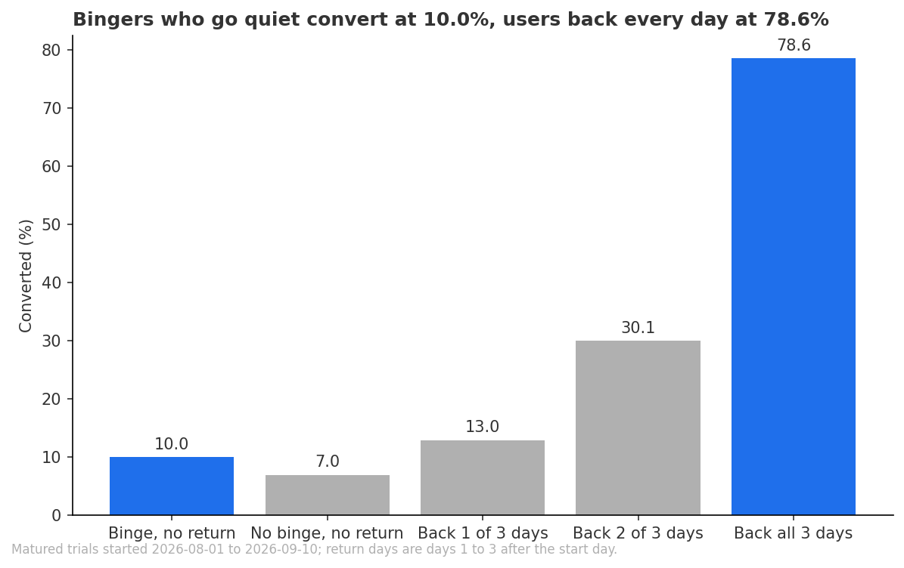
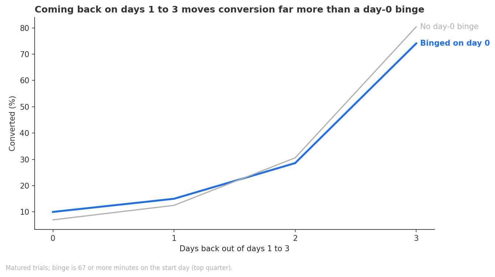
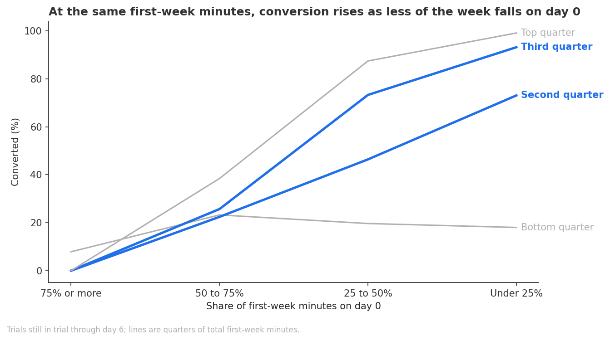

# Trial users who binge on day one and then go quiet

## Objective
Do trial users who binge on day one and then go quiet convert worse than steady users? The answer informs whether the onboarding emails should push trial users to spread their first week out, a decision the head of growth makes. Here the first day is the day the trial starts (day 0 in the charts), a binge is 67 minutes or more on that day (the top quarter of trial users), and coming back means a session on a later day.

## Key Takeaways
- Trial users who binged on their first day and then did not come back on any of the next three days converted at 10.0% (1 of 10), against 78.6% for users who came back on all three days, 68.6 percentage points lower.
- That pattern is rare, 10 of 1,553 finished trials (0.6%), while 312 trial users (20.1%) came back on at most one of the three days after their first and converted at 11.2%, 42.1 percentage points below the 53.3% of all finished trials.
- Coming back matters more than the binge: without a binge, conversion rose from 7.0% for users who never came back on days 1 to 3 to 80.4% for users back all three days, while at the same number of days back a first-day binge went with conversion from 3.0 percentage points higher to 20.9 points lower.
- Holding total first-week minutes level, users who put three quarters or more of their first week on the first day converted at 0.0% in the top three quarters of users by minutes, against 73.1% to 99.2% for users who put under a quarter there.

## Recommendations
1. Go ahead with onboarding emails that bring trial users back in the days after their first, and aim them at every trial user who has not come back, not only at bingers. First-day bingers who go quiet are 0.6% of trials, while users back on at most one of days 1 to 3 are 20.1% and convert at 11.2%.
2. Send them as a test. Hold a random share of new trial users out of the emails and compare trial conversion between the two groups once their 14 days are over. This data shows that users who come back convert; it does not show that an email which brings someone back makes them convert.
3. Do not build a separate track for first-day bingers. With 10 such users among trials started 2026-08-01 to 2026-09-10, their 10.0% has a 95% interval of 1.8% to 40.4%, too wide to measure an email against.

## Analysis
### Users who binged on their first day and then stayed away converted at 10.0%, against 78.6% for users back on all of the next three days.

**Figure 1:** Conversion by first-day binge and days back  
Source: `data/early_pattern_conversion.csv`, from `analysis.py`.

### Only 10 of 1,553 finished trials binged and then stayed away, so their 10.0% has a 95% interval of 1.8% to 40.4%.
| First-day binge | Days back (of days 1 to 3) | Trials | Share of trials (%) | Converted (%) | 95% interval (%) |
| --- | --- | --- | --- | --- | --- |
| No | 0 | 86 | 5.5 | 7.0 | 3.2 to 14.4 |
| No | 1 | 176 | 11.3 | 12.5 | 8.4 to 18.2 |
| No | 2 | 278 | 17.9 | 30.6 | 25.5 to 36.2 |
| No | 3 | 618 | 39.8 | 80.4 | 77.1 to 83.4 |
| Yes | 0 | 10 | 0.6 | 10.0 | 1.8 to 40.4 |
| Yes | 1 | 40 | 2.6 | 15.0 | 7.1 to 29.1 |
| Yes | 2 | 98 | 6.3 | 28.6 | 20.6 to 38.2 |
| Yes | 3 | 247 | 15.9 | 74.1 | 68.3 to 79.2 |

**Table 1:** Conversion by first-day binge and days back  
Source: `data/early_pattern_conversion.csv`, from `analysis.py`.

### Coming back on days 1 to 3 moves conversion far more than a first-day binge, from 7.0% to 80.4% without a binge.

**Figure 2:** Conversion by days back, bingers and non-bingers  
Source: `data/early_pattern_conversion.csv`, from `analysis.py`.

### Over the full first week, bingers converted up to 20.9 points less than non-bingers with the same number of active days.
| Active days in first week | Bingers | Converted (%) | Non-bingers | Converted (%) | Difference (points) |
| --- | --- | --- | --- | --- | --- |
| 2 | 4 | 0.0 | 51 | 9.8 | -9.8 |
| 3 | 12 | 0.0 | 99 | 8.1 | -8.1 |
| 4 | 28 | 17.9 | 98 | 19.4 | -1.5 |
| 5 | 39 | 28.2 | 126 | 45.2 | -17.0 |
| 6 | 66 | 56.1 | 182 | 76.9 | -20.9 |
| 7 | 189 | 87.3 | 399 | 95.0 | -7.7 |

**Table 2:** First-week conversion by active days, bingers and non-bingers  
Source: `data/binge_gap_by_active_days.csv`, from `analysis.py`.

### At the same first-week minutes, users who put three quarters or more on the first day converted at 0.0% above the bottom quarter, against 73.1% to 99.2% for those who put under a quarter there.

**Figure 3:** Conversion by the first day's share of first-week minutes  
Source: `data/day0_share_by_volume.csv`, from `analysis.py`.

### In the bottom quarter of first-week minutes, conversion stays between 7.9% and 23.3% however the week is spread.
| First day's share of first-week minutes | Bottom quarter (0 to 87 min) | Second quarter (88 to 175 min) | Third quarter (176 to 289 min) | Top quarter (290 min or more) | Notes |
| --- | --- | --- | --- | --- | --- |
| No first-week use | 0.0 (12) | -- | -- | -- | Only possible in the bottom quarter |
| Under 25% | 18.0 (183) | 73.1 (186) | 93.2 (222) | 99.2 (247) | |
| 25 to 50% | 19.7 (61) | 46.4 (84) | 73.3 (75) | 87.5 (72) | |
| 50 to 75% | 23.3 (43) | 22.4 (49) | 25.7 (35) | 38.5 (13) | |
| 75% or more | 7.9 (38) | 0.0 (15) | 0.0 (8) | 0.0 (6) | Small groups |

**Table 3:** Converted (%) and trials, by first day's share and first-week minutes  
Source: `data/day0_share_by_volume.csv`, from `analysis.py`.

## Checks
- **Review:** Think on it (`review.md`)
- **Verified:**
  - Rerunning the three headline queries returned exactly the saved results.
  - A separate query, built without the analysis's shared steps, reproduced 1 of 10, 680 of 865, 35 of 312, and 828 of 1,553.
  - Joining trials to sessions and users kept one row per trial (1,553), and first-week sessions (28,251) and minutes (299,652) matched a direct count.
  - Only finished trials are counted, and none of them lacks an outcome.
  - Trial starts run from 2026-08-01 to 2026-09-10, the last trial ends on 2026-09-24, and first-week sessions run from 2026-08-01 to 2026-09-16.
  - Every split adds back to its total.
  - A short first day does not distort the binge flag: the 24.8% of trials that started at 18:00 or later binged at 23.4%, against 26.1% for earlier starts.
  - The groups do not differ much in who they are: steady users are 77.8% to 87.7% of every device, market, and start week.
- **Not verified:**
  - Review finding 1 is only partly applied. The chart title and Table 2 now show the binge gap, but the review also found that among users back all three days, heavier bingers (113 minutes or more) converted at 55.8%, against 81.1% for non-bingers, 25.3 percentage points lower. That figure comes from the review's checks, not from `analysis.py`.
  - Review finding 3 cannot be settled with this data. It shows that coming back goes with converting, not that an email which brings users back raises conversion. Only a holdout test can show that.
  - 520 trials started after 2026-09-10 had not finished their 14 days by 2026-09-24 and are left out: 418 still open and 102 canceled before day 14.
  - Table 2, Table 3, and Figure 3 leave out 204 finished trials canceled on days 4 to 6. Figure 1, Figure 2, and Table 1 include them.
  - Session dates and trial start times are assumed to be in the same time zone.
  - Activity on days 7 to 13 was not examined.
  - Nobody tested whether the gaps differ by device or market within each usage group.
- **Quirks:**
  - Open trials are counted only once their 14 days are over, never as failures.
  - Cancellations are recorded on the day they happen and conversions only on day 14. So the three-day view uses days before any cancellation (the earliest is day 4), and the first-week tables keep only trials still running through day 6.
  - Trial starts and sessions are compared as calendar dates, not timestamps.
  - Sessions dated 2026-09-25 and 2026-09-26 fall outside every first-week window, which all end by 2026-09-16.
  - Trials launched on 2026-08-01, so only trials started 2026-08-01 to 2026-09-10 have results.
